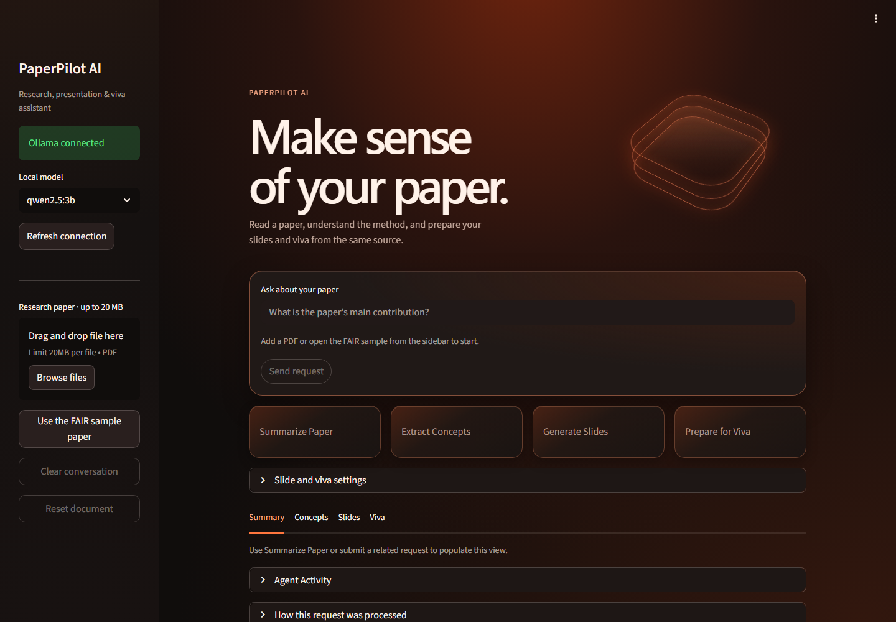
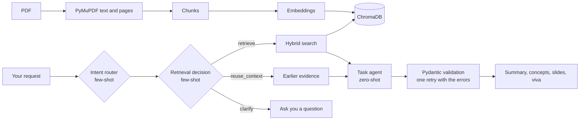

# PaperPilot AI

**Turn one research paper into a summary, concept explanations, slides and a viva you can practise, with the PDF pages behind every answer.**

PaperPilot AI is a local, agentic RAG assistant for students. A local model served by Ollama reads your paper through a ChromaDB index, decides when it needs to search, and shows its routing, retrieval and the excerpts it used. Nothing leaves your machine once setup is done.



[Mobile view](ui/mobile.png) · [Project website with a recorded demo](site/index.html)

## What it does

| | |
|---|---|
| **Summary** | Eight fields: overview, problem, objective, methodology, findings, contributions, limitations, conclusion. |
| **Concepts** | Up to four concepts, labelled as from the paper (cited) or background (uncited). |
| **Slides** | An editable PowerPoint deck with the pages behind each slide. |
| **Viva practice** | Questions with easy, intermediate or advanced answers. Type your own answer and get advisory scores for correctness, depth and clarity (0 to 5), one next step and the supporting pages. |
| **Follow-ups** | "Make your previous explanation shorter" reuses the earlier evidence instead of searching again. |
| **Session report** | Download a Markdown report of requests, results, citations, viva attempts and the agent activity. |
| **Transparency** | Every result has **Paper evidence**, **Agent Activity** and **How this request was processed**, which shows the system and user prompts. |

## How it works



1. **Extract.** PyMuPDF reads page text. Papers over 20 MB, 150 pages or one million characters, and password-protected files, are refused with a clear message.
2. **Index.** LangChain splits the text into overlapping chunks. Each chunk is embedded and stored in a document-specific ChromaDB collection with its page number.
3. **Route.** A few-shot LangChain prompt classifies the request: summary, concepts, slides, viva, clarification or general.
4. **Decide.** A second prompt decides whether to search, reuse the previous evidence, or ask you to clarify.
5. **Retrieve.** With the semantic index, search is **hybrid**: MiniLM similarity is fused with exact-word matching by reciprocal rank fusion, so a passage that uses the paper's own term is not lost when its meaning match is weak.
6. **Generate and validate.** A zero-shot task prompt returns JSON for a schema. Pydantic validates it, and an invalid answer goes back to the model once with the errors as feedback (a reflection step).

Every prompt is a LangChain `ChatPromptTemplate` composed with the model and an output parser using LCEL: `prompt | model | StrOutputParser()`.

### Two search indexes

| Index | Needs | Good at |
|---|---|---|
| **Semantic · MiniLM** (default) | A one-time 88 MB model download | Paraphrases and meaning, plus exact-word matching through hybrid search |
| **Offline lexical** | Nothing | Papers where the question reuses the paper's vocabulary, on a machine with no model download |

Choose the index in the sidebar. Switching it clears the loaded paper, because the vectors differ.

## Quick start

Use Python 3.12 (the version used for Windows verification). Run these commands from the directory containing `app.py`.

### Windows · PowerShell

Install Ollama using the [official Windows installer](https://ollama.com/download/windows). Open Ollama, then use PowerShell.

```powershell
py -3.12 -m venv .venv
.\.venv\Scripts\Activate.ps1
python -m pip install --index-url https://download.pytorch.org/whl/cpu torch==2.8.0
python -m pip install -r requirements.txt
python -m sample_data.setup_embeddings
ollama pull qwen2.5:3b
python -m streamlit run app.py
```

If activation is disabled in PowerShell, use `.\.venv\Scripts\python.exe` in place of `python`. If Ollama is installed as a standalone CLI, run `ollama serve` in a separate terminal before pulling the model.

### Linux · Bash

Install Python 3.12 with its venv module and [Ollama for Linux](https://docs.ollama.com/linux). If Ollama is installed without a service, leave `ollama serve` running in another terminal.

```bash
python3.12 -m venv .venv
source .venv/bin/activate
python -m pip install --index-url https://download.pytorch.org/whl/cpu torch==2.8.0
python -m pip install -r requirements.txt
python -m sample_data.setup_embeddings
ollama pull qwen2.5:3b
python -m streamlit run app.py
```

Open [the local workspace](http://127.0.0.1:8501) and use the FAIR sample or upload your own PDF. To skip the MiniLM download, leave out `python -m sample_data.setup_embeddings` and choose **Offline lexical** in the sidebar.

The model pull downloads about 1.9 GB. Allow several GB of free disk space for packages, caches and the Ollama runtime. Dependencies and model weights need network access during setup. PDF processing, embedding, search, generation and export run locally afterward.

## Try these requests

1. "Summarize this paper in simple language."
2. "Explain the methodology and important concepts."
3. "Make your previous explanation shorter."
4. "Create six presentation slides based on this paper."
5. "Generate ten viva questions with easy answers."

Open a viva question, choose **Practise your answer**, type a response and select **Get feedback**. Then use **Download session report** in the sidebar.

## Configuration

| Setting | Default | Purpose |
|---|---|---|
| `PAPERPILOT_OLLAMA_PORT` | `11434` | Port of the local Ollama server |
| `PAPERPILOT_MAX_UPLOAD_MB` | `20` | Upload limit. Match `server.maxUploadSize` in `.streamlit/config.toml` |
| `HF_HOME` | `~/.cache/huggingface` | Where the MiniLM weights live. Use the same value at setup and launch |
| `OLLAMA_NO_CLOUD` | unset | Set to `1` before starting Ollama to disable its cloud features |

Ollama and Streamlit listen on loopback. PaperPilot uses a local Ollama endpoint, omits cloud model tags from the selector, and never downloads a model by itself. You can choose another installed instruction model in the sidebar.

## Project website

[`site/`](site) is a static website for PaperPilot, with a **recorded demo** of the workspace. The demo replays real output from a local run on the FAIR sample paper, including the agent activity, routing and cited pages. It is labelled as a recording and does not call a model, so it works on any static host.

Deploy on Vercel: import this repository, set **Root Directory** to `site`, set **Application Preset** to **Other**, and leave the build and output settings empty.

## Verification

```bash
python -m pytest -m "not live" -q
python -m pytest -m live -s
```

The first command runs the offline suite: PDF parsing and limits, Chroma mechanics with controlled vectors, hybrid and lexical search, prompt structure, orchestration with a mocked model, viva feedback, the session report and real PowerPoint serialization. The second needs Ollama and the MiniLM weights and verifies genuine retrieval and generation end to end. Set `PAPERPILOT_DEMO_PPTX` to an output path to save the live deck. See the [acceptance checklist](docs/ACCEPTANCE_CHECKLIST.md) and the [demo guide](docs/DEMO_GUIDE.md).

## Assignment criteria

| Criterion | Where it is shown |
|---|---|
| LLM integration | `ChatOllama` with a local Qwen2.5 3B model (`core/llm.py`) |
| Interactive GUI | Streamlit workspace (`app.py`, `ui/`) |
| Prompt engineering | Few-shot router and retrieval prompts, zero-shot task prompts, a reflection retry. System and user prompts are shown in **How this request was processed** (`prompts/templates.py`) |
| LangChain core components | `ChatPromptTemplate` and LCEL chains (`core/llm.py`) |
| Agentic RAG | The agent chooses `retrieve`, `reuse_context` or `clarify` (`core/workflow.py`) |
| Intent detection and routing | A router classifies the request and selects the task agent |
| Vector database | ChromaDB with cosine similarity (`core/vector_store.py`) |

## Troubleshooting

- **Ollama unavailable.** Check `ollama list`, then click **Refresh connection**. Open the Ollama desktop app or start `ollama serve`.
- **Ollama stalls during GPU initialization.** For a CPU-only NVIDIA workaround on Windows, exit the Ollama desktop app, set `$env:CUDA_VISIBLE_DEVICES='-1'` and `$env:OLLAMA_VULKAN='0'` in PowerShell, then run `ollama serve` in that terminal.
- **No local model listed.** Run the model pull yourself, then refresh. The app performs no automatic model downloads.
- **Embedding model unavailable.** Run `python -m sample_data.setup_embeddings` using the same `HF_HOME`, or choose the offline lexical index.
- **Unreadable PDF.** For a scan, OCR it first and upload the text-based copy. For a locked paper, upload an unlocked copy.
- **Bad structured response.** Use a focused request or a quick action, or try a stronger installed model.
- **No evidence.** Try a named section or term and inspect the retrieved excerpts.
- **Tests fail with a `langchain` import error.** Use the project's virtual environment. A global Python with a newer `langchain` conflicts with the pinned `langchain-core`.

## Limitations

PaperPilot is a study aid. It tells you where its answers come from, but it cannot guarantee they are right.

- **One paper at a time.** The index and conversation history are temporary. Download the session report to keep a record.
- **Text, not figures.** Figures, tables, formulas and complex reading order can lose meaning when text is extracted. A scanned PDF needs OCR first.
- **Search can still miss.** Hybrid search reduces missed passages but does not remove them. Name a section or a term if nothing useful turns up.
- **A page is not proof.** Page validation confirms a page was given to the model, not that the answer is correct. Read the excerpts.
- **Model-dependent.** Speed and structured-output reliability depend on the model and the computer. A 3B model can still produce weak answers.
- **Feedback is advisory.** Viva scores are the local model's judgment, not a grade.
- **Size limits.** 20 MB, 150 pages and one million characters per paper.

## Documentation

- [Architecture](docs/ARCHITECTURE.md) · [Code walkthrough](docs/CODE_WALKTHROUGH.md) · [Project folder tree](docs/FILE_TREE.md)
- [Project report](docs/PROJECT_REPORT.md) · [Demo guide](docs/DEMO_GUIDE.md) · [Viva guide](docs/VIVA_GUIDE.md)
- [FAIR sample attribution](sample_data/README.md)

## Credits

The offline lexical index, typed viva feedback and the session report were inspired by [Paperloom Research Studio](https://github.com/SolvyrEryx/paperloom-research-studio) by Rahul J (MIT licence), rebuilt here for a local Ollama stack. The FAIR sample paper is attributed in `sample_data/README.md`.
