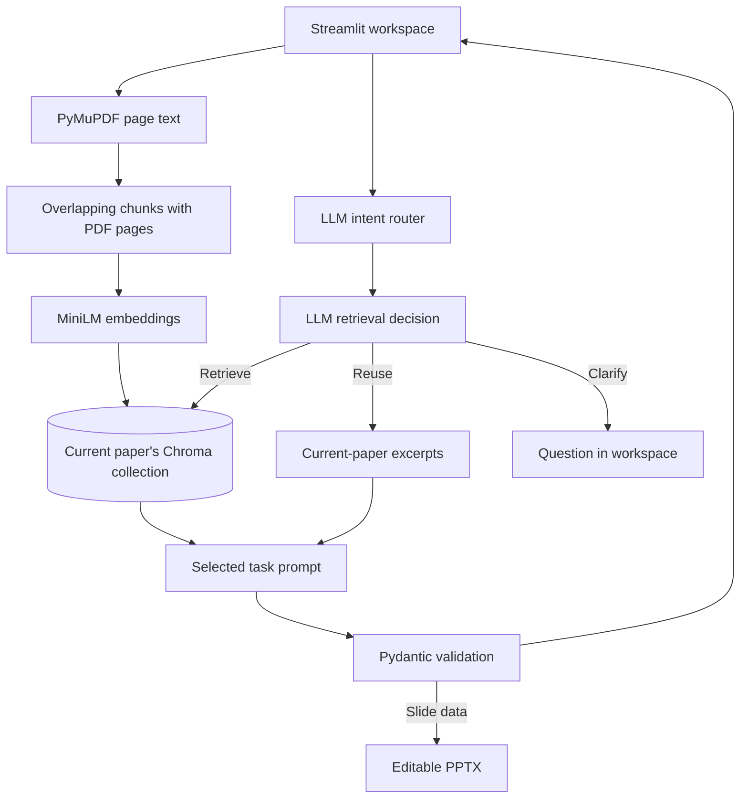
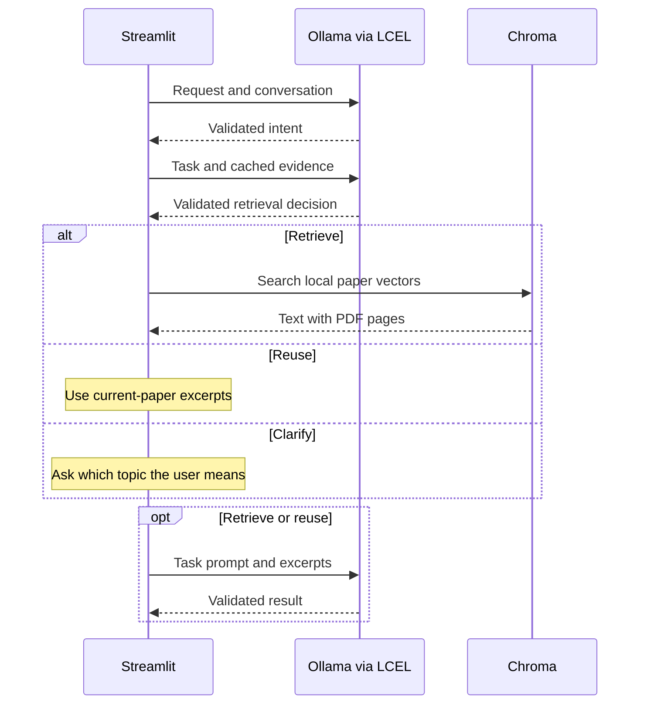

# Architecture

## Document ingestion

`extract_paper` checks the size and header, opens the PDF, and extracts text in page order. Recognized standalone headings label nearby text. LangChain splits each page section into chunks of up to about 1,000 characters with up to 150 characters of overlap. The overlap helps preserve meaning when a passage crosses a chunk boundary. Each chunk keeps its one-based page, ID, section, filename, and document hash.

`PaperIndex` embeds chunk batches using a pinned MiniLM model on CPU. Chroma stores vectors, text, and metadata together. The same embedding model converts the search query to a vector. Chroma uses cosine distance to return nearby chunks. The app retains an index on ordinary reruns and removes the active collection on replacement or reset.

## One shared local model

`local_model` configures ChatOllama with a loopback URL and an 8,192-token context. `structured_call` binds the schema and runs `prompt | model | StrOutputParser()`. Pydantic parses the string and validates the data. Format failures get one correction attempt. Routing and retrieval prompts use example exchanges. The four task templates use instructions without examples.

## Conditional retrieval

`run_request` routes natural-language input to summary, concepts, slides, viva, clarification, or app help. Quick actions provide a route directly. The retrieval decision receives the request, prior turn information, and selected cached excerpts. A revision with evidence can reuse that evidence. New factual tasks require retrieval. Clarification and app help can return without a search.

A broad request searches the user topic plus three section-oriented queries. A targeted request searches the focused query. The workflow deduplicates and caps the excerpt text. An insufficient result triggers up to one additional targeted search. The workflow answers from the evidence available, and checks that output page references appear in that evidence.

The workflow also validates a few narrowly defined cases. An unqualified comparison with no prior discussion gets a specific clarification question. For a request for an exact currency amount, the answer and excerpts must contain a matching explicit amount. A missing amount follows the insufficient-evidence path. This is a check on evidence availability and does not establish which entity a figure belongs to.

## Four task outputs

The summarizer fills eight research sections. The concept extractor labels general background separately from paper facts. The slide generator returns a validated list of five to ten slides with short bullets. The viva agent returns an ordered list of questions, answers, difficulty, and citations.

The four agents share the same model object for a request. Prompt instructions and schemas determine their roles. The workflow owns retrieval and validation. Streamlit keeps recent turns, excerpts, the model selection, activity, and exported slide bytes. The export uses a widescreen title slide, content slides, and source-page footers.
